# MasterGo 1.12.2 功能清单与操作流程拆解

> 分析对象：`MasterGo-1.12.2.exe`（NSIS 安装包，86,248,632 字节）
> 分析方式：REA 静态拆解安装包 + 客户端运行期日志/本地服务探测 + 登录后网页版（与客户端同一云编辑器）实测走查截图
> 分析日期：2026-10-26

---

## 1. 产品概览

| 项目 | 结论 |
|---|---|
| 产品定位 | 在线协作式 UI/UX 设计与原型工具（Figma 同类），含 AI 生成、资源社区、插件体系 |
| 桌面端版本 | 1.12.2，构建日期 2026-10-15，commit `15985c4efdb7` |
| 技术栈 | Electron 31.7.6 / Chromium 126.0.6478.234 / Node 20.18.0 |
| appId | `com.master.electron` |
| 安装包签名 | 有效 Authenticode，签名主体：北京创作美好科技有限公司 |
| 核心形态 | **桌面端只是外壳**：主窗口加载云端页面 `https://mastergo.com/files/home`，编辑器 UI 全部在云端；安装包内无编辑器前端代码 |
| 本地补充能力 | 本地字体服务、AI 本地桥接（LocalAiCanvas）、文件打开/深链、自动更新、系统托盘 |

---

## 2. 桌面客户端（安装包内）能力清单

### 2.1 主进程与窗口

| 功能 | 说明 |
|---|---|
| 多标签窗口 | 支持多文件标签页，菜单含「关闭标签 Ctrl+W」「关闭窗口 Ctrl+Shift+W」 |
| 单实例运行 | 已启动时二次启动会聚焦已有窗口，并把命令行参数转交主实例 |
| 私有协议 `app://` | 本地壳页面通过自定义协议加载（`app://./index.html`），关闭了 `webSecurity` 与 CSP |
| 深链 | 支持 `mastergo://` 协议，以及 `.mg` / `.mxgp` 文件关联，双击文件可唤起客户端打开 |
| 网页↔客户端跳转 | 网页端点击文件链接时可「在浏览器打开」或「在客户端打开」（偏好设置可切换） |
| 排查工具 | 客户端菜单提供「获取日志」「排查问题」（AI 快搭首次使用会引导用户执行该检查） |

### 2.2 本地服务（运行期探测）

| 端口 | 服务 | 主要接口 |
|---|---|---|
| 26162 | Express 本地服务（CORS 全开放） | `/app-auth/redeem`、`/open-file`、`/set-size`、`/settings` 系列 |
| 26062 | 本地字体服务 `master-local-fonts-win.exe` | 字体列表同步（通过 `version.json` 校验版本） |

补充发现：运行日志中反复出现 `[LocalAiCanvas] Local AI Canvas /capi 代理目标`，说明客户端内置了 **面向 AI 能力的本地代理桥**，登录/登出时会清理该桥接授权。

### 2.3 更新与运维

- `electron-updater` + `NsisUpdater`，运行时更新源 `static-nc.mastergo.com/plugins/desktop/windows`
- `allowDowngrade: true`、`autoDownload: false`（可降级、需确认下载）
- 崩溃监控：Sentry DSN 硬编码在主进程中

### 2.4 安全观察（需关注）

主窗口 `nodeIntegration: true`、`contextIsolation: false`、启用 `@electron/remote`；启动参数无条件包含 `--no-sandbox`、`--ignore-certificate-errors`、`NODE_TLS_REJECT_UNAUTHORIZED=0`、`--disable-quic`、`--no-proxy-server`；本地 26162 端口 CORS 全开放。页面无 CSP，属于偏宽松的桌面壳安全配置。

---

## 3. Web/客户端主功能清单与操作流程

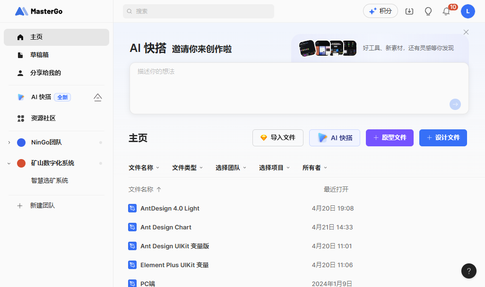

### 3.1 全局框架

- 左侧常驻导航：主页 / 草稿箱 / 分享给我的 / AI 快搭（全新）/ 资源社区 / 团队列表 / 新建团队
- 顶部：全局搜索、积分、导出记录、通知（未读角标）、头像菜单
- 头像菜单项：前往官网、切换深色模式、切换英文、个人设置、退出登录

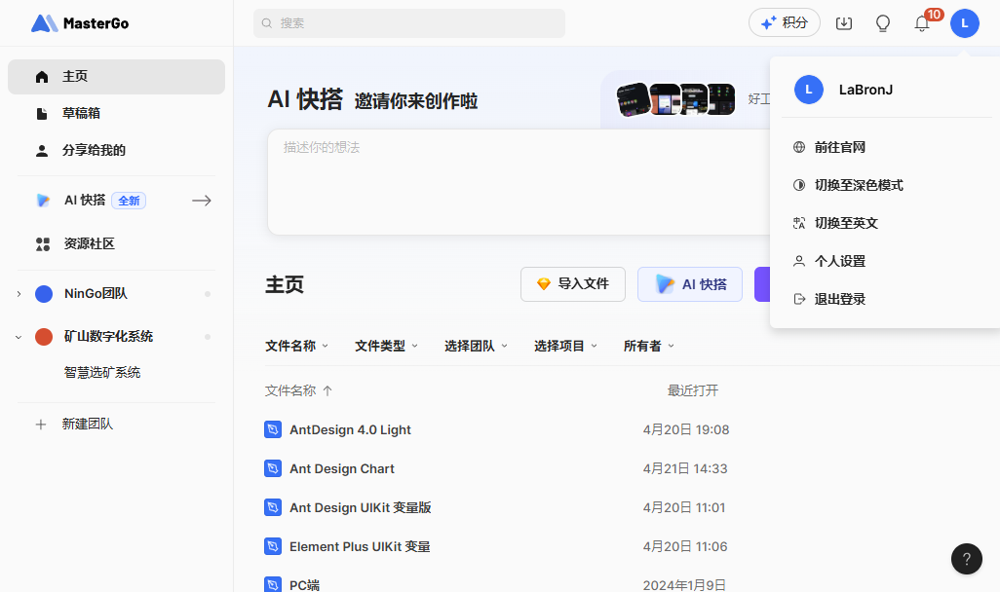

**操作流程（进入任意模块）**：登录 → 左侧导航点击目标模块 → 顶部工具栏按需筛选 → 双击文件卡片进入编辑器。

---

### 3.2 主页（文件工作台）

功能点：

- 文件列表展示：文件名称、最近打开时间、所属团队/项目标记（如「团队库」）
- 顶部动作区：**导入文件**、**AI 快搭**、**原型文件**、**设计文件**
- 筛选维度：文件名称（搜索）、文件类型、选择团队、选择项目、所有者
- 排序：文件名 / 最近打开，可升降序
- 右上角操作：导出记录、通知中心、账号菜单

**操作流程（新建文件）**：主页 → 「设计文件」/「原型文件」→ 选择目标团队与项目 → 进入空白编辑器。

**操作流程（导入文件）**：主页 → 「导入文件」→ 选择本地设计文件（Sketch 等）→ 选择团队/项目 → 云端解析。

---

### 3.3 草稿箱

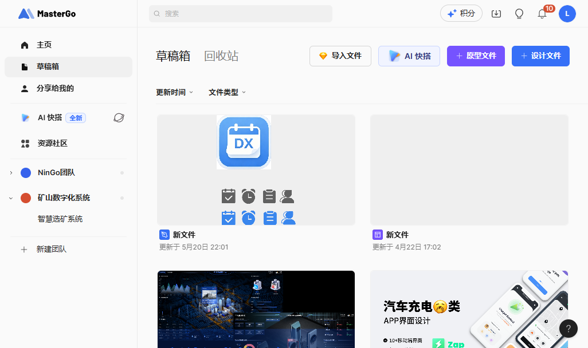

- 收纳未归属团队的个人文件，避免混入团队资产
- 与主页共用同一套列表组件（筛选、排序、所有者、文件类型）

**操作流程**：左侧「草稿箱」→ 查看/管理个人草稿 → 需要协作时再移动至团队项目。

---

### 3.4 分享给我的

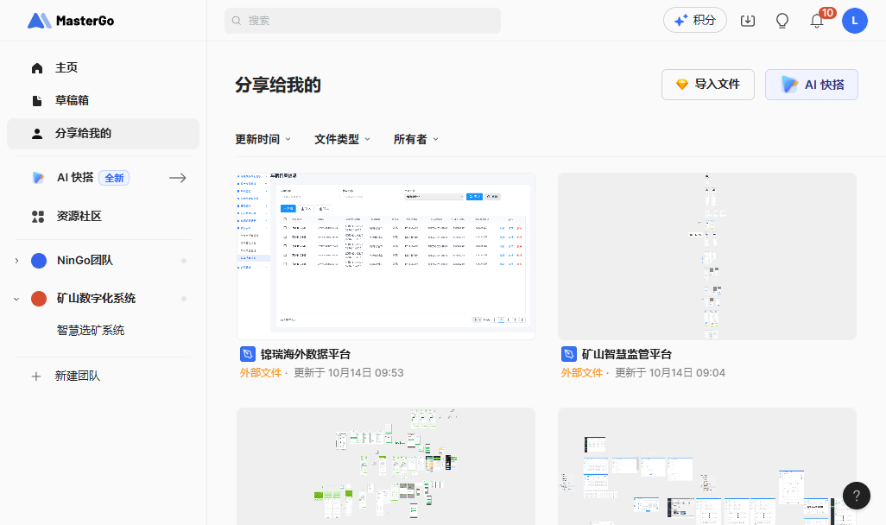

- 展示他人分享的外部文件，标注「外部文件」与更新时间
- 筛选维度：更新时间、文件类型、所有者

**操作流程**：他人分享链接 → 打开后进入此处 → 双击打开编辑或复制到自己的团队。

---

### 3.5 团队空间

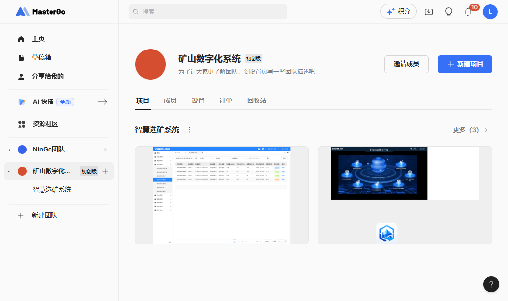

团队页包含 5 个页签：**项目 / 成员 / 设置 / 订单 / 回收站**

- 团队头部：「邀请成员」「新建项目」；未填写描述时提示补充团队介绍
- 项目区：按项目分组文件（如「智慧选矿系统」），项目内可「更多」操作
- 版本标识：如「初创版」

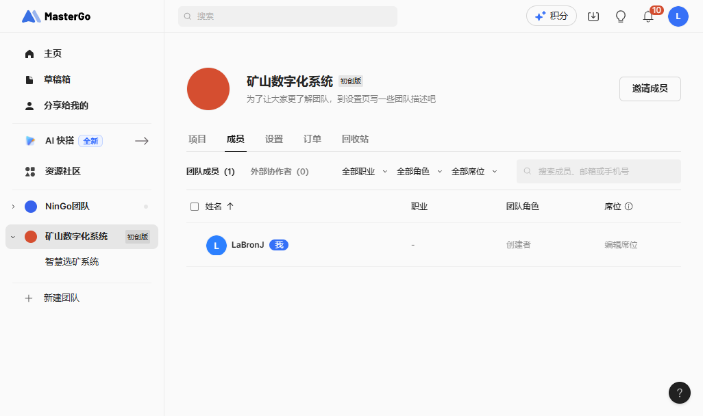

**成员管理**：团队成员（N）/ 外部协作者（N）切换；筛选条件为职业、团队角色、席位；列表字段为姓名、职业、团队角色、席位（如「创建者 / 编辑席位」）。

**操作流程（团队协作）**：进入团队 → 新建项目 → 项目内新建设计文件 → 分享给成员 → 在成员页配置角色与席位。

---

### 3.6 资源社区

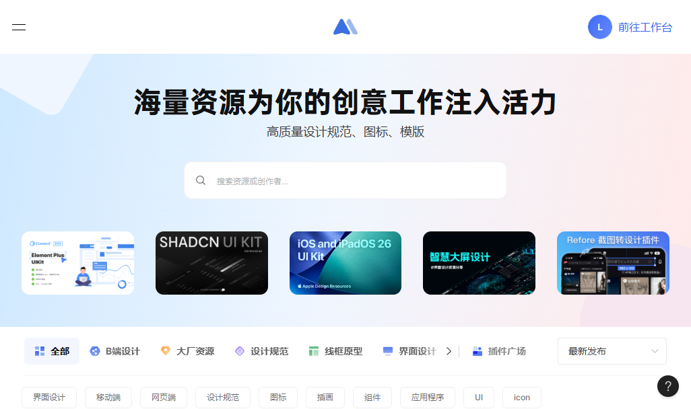

- 资源分类：全部、B 端设计、大厂资源、设计规范、线框原型、界面设计、图标、插画、3D、样机、指南
- 内容形态：设计规范、图标、模板、组件库、插件广场
- 卡片信息：封面、名称、作者、点赞数、使用量
- 支持「前往工作台」返回主站

**操作流程（使用社区资源）**：资源社区选分类 → 打开资源详情 → 复制/使用到自己的文件。

---

### 3.7 AI 快搭

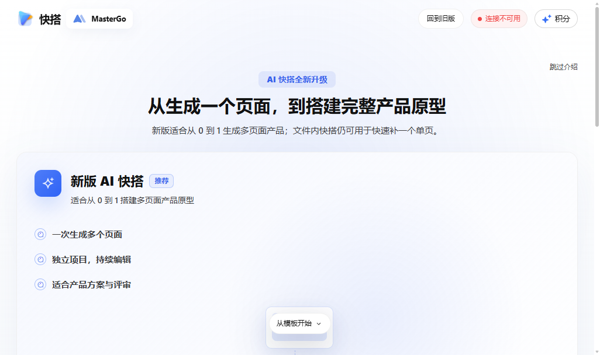

实测页面区分两条产品线：

| 形态 | 适用场景 | 入口 |
|---|---|---|
| **新版 AI 快搭**（推荐） | 从 0 到 1 生成**多页面**产品原型，独立项目空间，可持续编辑 | 工作台左侧「AI 快搭」/ 主页「AI 快搭」 |
| **文件内快搭** | 在已有文件里快速补**单个页面** | 打开设计/原型文件 → 顶部 **MasterGo AI** → 文件内快搭 |

其他要点：

- 首次使用会弹出「先检查一次本地能力」引导，要求客户端执行「排查问题」，并显示「连接不可用 / 当前：浏览器」状态提示 —— 说明**新版快搭的生成/预览依赖客户端本地能力**
- 推荐模板区：选择模板后 AI 基于模板生成**可编辑页面与代码**
- 最近打开：记录历史生成会话
- 「回到旧版」可切换旧版快搭

**操作流程**：进入 AI 快搭 → 首次按引导完成本地能力检查 → 选择「开始生成多页面」或模板 → 输入想法 → 生成可编辑页面 → 在独立项目中继续编辑。

> 注：该页面实测时提示连接不可用，因为当前在浏览器中打开（未通过已登录客户端）。这是「桌面端 + 云端」双端耦合的直接证据。

---

## 4. 设计编辑器功能清单

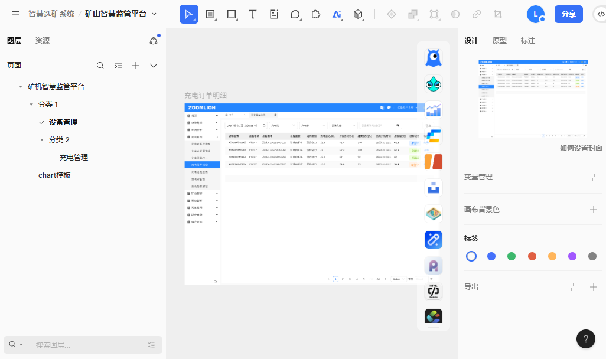

### 4.1 界面结构

- 顶部：主菜单（☰）、团队/文件名、协作头像、分享按钮、缩放比例
- 工具条：移动/画板/矩形/文本/组件/容器/钢笔/切片/图片、AI、插件、分隔后的蒙版/裁剪/旋转等、链接
- 左栏：**图层 / 资源** 双页签 + 「页面」树（页面 → 分组 → 画板）
- 右栏：**设计 / 原型 / 标注** 三页签
- 画布：底部缩放条、网格、辅助线
- 右侧浮动图标轨：AI、图片填充、组件库、图标库、字体、插件等快捷入口

### 4.2 设计面板（选中对象后）

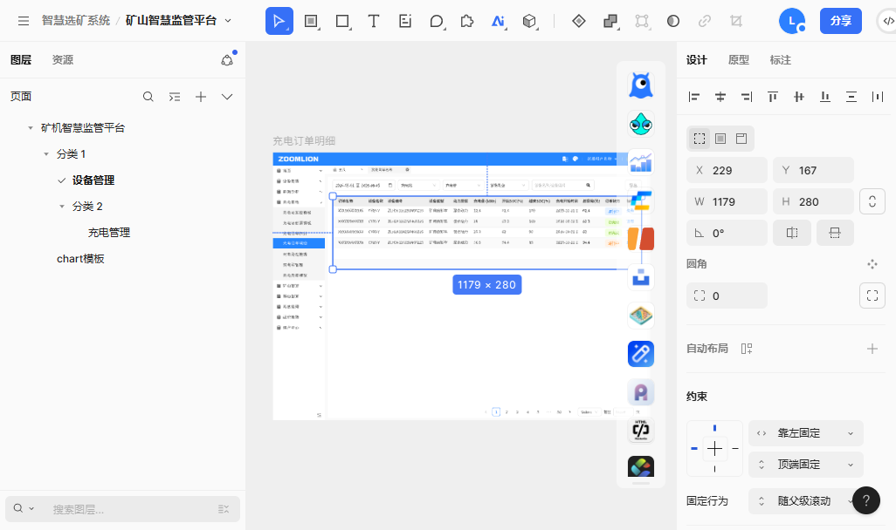

- 圆角、自动布局、约束（靠左固定 / 顶端固定）、固定行为（随父级滚动）
- 图层、填充、描边（内描边 / 颜色选集 / 查看全部 N 个颜色）、特效、导出
- 支持多选后统一改属性（出现「存在不同属性值，可点击 + 号替换」）

**操作流程（改一个元素）**：画布或图层点选对象 → 右栏「设计」→ 修改圆角/填充/描边 → 画布实时生效。

### 4.3 原型面板

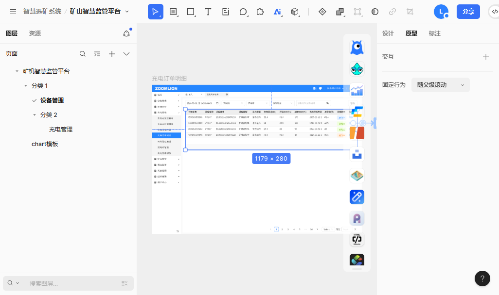

- **交互**：给元素添加交互（跳转、点击、悬停等），带「+」添加入口
- **固定行为**：随父级滚动 / 固定位置，用于滚动容器内元素

**操作流程（做一条交互）**：切到「原型」→ 选中热区 → 点「交互 +」→ 选择目标画板与触发方式 → 画布生成连线。

### 4.4 标注（研发交付）

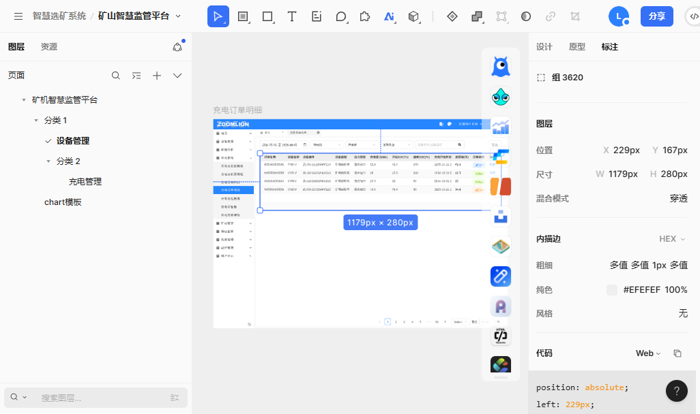

- 位置（X/Y）、尺寸（W/H）、混合模式
- 内边距、描边（HEX、粗细多值、纯色 #EFEFEF、100%）、风格
- **代码面板**：语言切换（Web 等），自动生成 CSS（`position/left/top/width/height/opacity/box-sizing/border-*`），支持一键复制
- 导出

**操作流程（交付）**：切到「标注」→ 选中组件 → 读取尺寸/间距 → 复制 CSS 交给研发。

### 4.5 资源库（左栏「资源」）

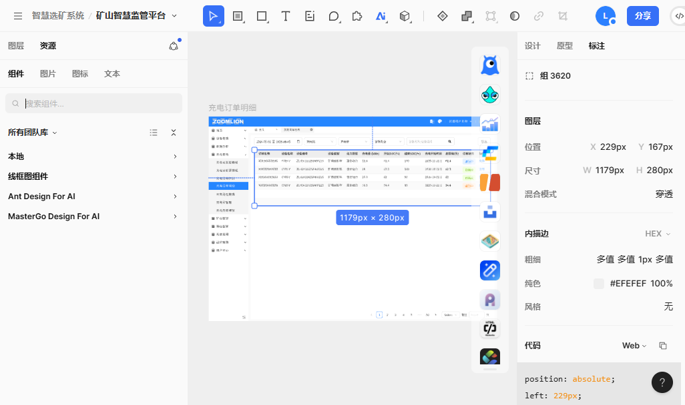

- 顶部子页签：**组件 / 图片 / 图标 / 文本**
- 库来源：所有团队库、本地、线框图组件、**Ant Design For AI**、**MasterGo Design For AI**
- 搜索框（搜索组件…）

**操作流程**：左栏「资源」→ 选库 → 搜索/Navigate → 拖拽组件到画布 → 右侧可「替换」实例。

### 4.6 分享与协作

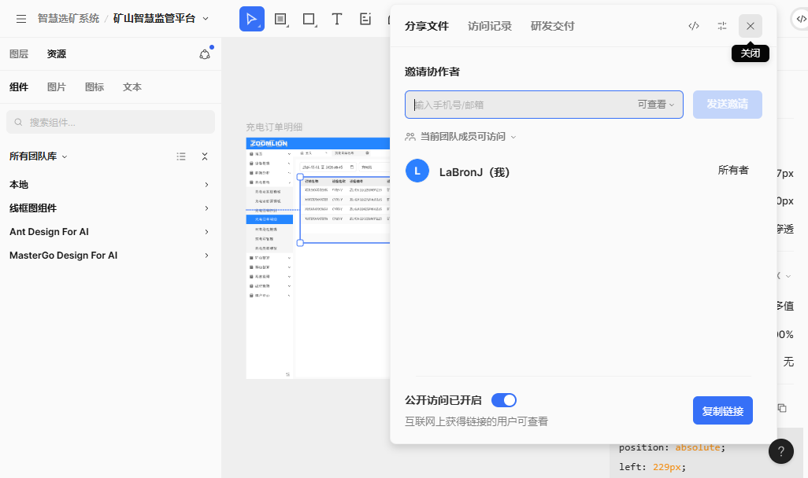

- 面板页签：**分享文件 / 访问记录 / 研发交付**
- 邀请协作者：权限下拉（可查看等）→「发送邀请」
- 团队可见性：当前团队成员可访问
- 公开访问开关：开启后互联网获得链接的用户可查看
- 「复制链接」；画布内可加评论（协作评论）

**操作流程（邀请协作）**：编辑器右上「分享」→ 输入成员/邮箱 → 设权限 → 发送邀请 → 对方在「分享给我的」或团队空间看到文件。

### 4.7 文件菜单

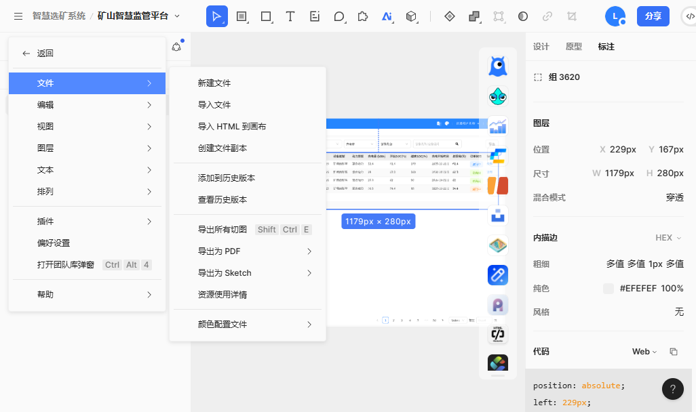

| 菜单项 | 功能 |
|---|---|
| 新建文件 | 在当前团队新建设计文件 |
| 导入文件 | 导入本地设计文件 |
| 导入 HTML 到画布 | 把网页 HTML 转成画布图层 |
| 创建文件副本 | 复制当前文件 |
| 添加到历史版本 / 查看历史版本 | 版本快照与回溯 |
| 导出所有切图（Shift+Ctrl+E） | 批量导出切片 |
| 导出为 PDF | 整页 PDF |
| 导出为 Sketch | 反向导出为 Sketch 文件 |
| 资源使用详情 | 查看文件内资源占用 |
| 颜色配置文件 | 色彩管理 |

### 4.8 主菜单其他分组

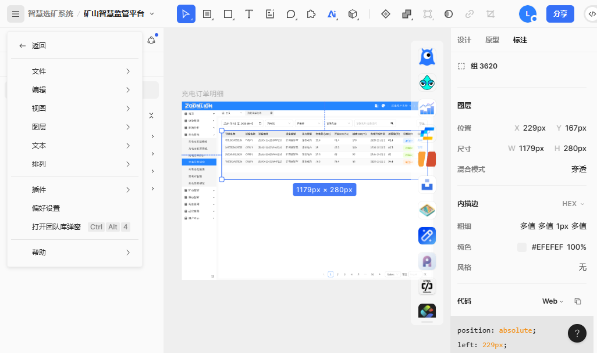

返回、文件、编辑、视图、图层、文本、排列、插件、偏好设置、打开团队库弹窗（Ctrl+Alt+4）、帮助。

### 4.9 偏好设置

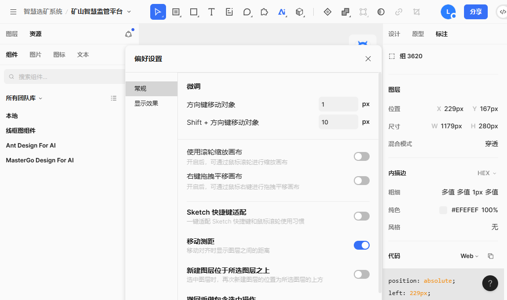

分组：**常规 / 显示效果 / 微调**

- 微调：方向键移动距离、Shift+方向键移动距离
- 显示效果：滚轮缩放画布、右键拖拽平移、Sketch 快捷键适配、移动测距
- 常规：新建图层位于所选图层之上、撤回重做包含选中操作、**在客户端打开文件链接**

### 4.10 插件体系

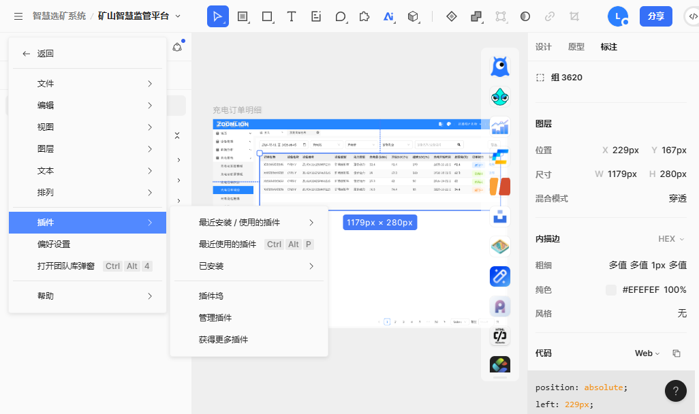

- 最近安装/使用的插件、最近使用的插件（Ctrl+Alt+P）、已安装、插件坞、管理插件、获得更多插件
- 编辑器右下角常驻插件横幅（实测为「Codify MCP - Vibe Design」），可一键唤起
- 资源社区内设「插件广场」

**操作流程**：主菜单「插件」→「获得更多插件」→ 插件广场安装 → 「已安装」中运行 → 部分插件在右侧插件坞常驻。

### 4.11 导出

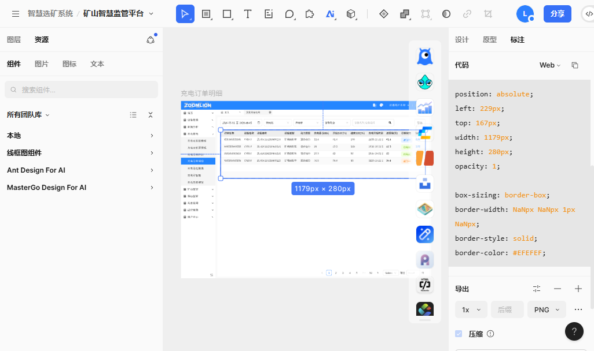

- 选中对象后在右栏「导出」行点「+」添加导出配置 → 弹出「导出 组 xxx」面板
- 面板含 **预览** 与 **压缩** 选项；配合文件菜单可导出 PDF / Sketch / 全部切图

**操作流程（切图）**：选中图层 → 右栏「导出 +」→ 选格式与倍率 → 预览 → 导出 → 到主页「导出记录」下载。

---

## 5. 功能清单速查表

| 模块 | 核心功能 |
|---|---|
| 账号 | 微信登录、账号密码、验证码登录、SSO、注册、忘记密码、服务/隐私协议 |
| 工作台 | 主页、草稿箱、分享给我的、文件搜索/筛选/排序、导入、新建、AI 快搭、导出记录、通知 |
| 团队 | 项目、成员（角色/席位/外部协作者）、设置、订单、回收站、邀请成员、新建项目、团队库 |
| 资源社区 | 12 类资源分类、模板/图标/插画/3D/样机、插件广场 |
| AI | 新版 AI 快搭（多页面、独立项目、模板生成可编辑页面+代码）、文件内快搭、MasterGo AI 入口 |
| 编辑器 | 画板/矩形/文本/组件/容器/钢笔/切片/图片、AI、插件、蒙版/裁剪/旋转、链接 |
| 设计属性 | 圆角、自动布局、约束、固定行为、填充、描边、特效、导出、多选混合值 |
| 原型 | 交互连线、触发方式、固定行为（滚动/固定） |
| 标注 | 尺寸/位置/间距、内边距、描边、CSS 代码生成与复制 |
| 资源库 | 组件/图片/图标/文本、团队库、本地库、Ant Design For AI、MasterGo Design For AI |
| 协作 | 分享、邀请协作者、权限（可查看等）、公开访问、复制链接、访问记录、研发交付、评论 |
| 文件 | 新建/导入/导入 HTML/副本/历史版本/导出切图/导出 PDF/导出 Sketch/资源使用详情/颜色配置 |
| 插件 | 插件广场、已安装、插件坞、管理插件、开发者插件 |
| 设置 | 常规、显示效果、微调、客户端打开链接 |
| 桌面端 | 多标签、单实例、深链、文件关联、托盘、自动更新（可降级）、本地字体服务、AI 本地桥、日志/排查 |

---

## 6. 截图索引

| 文件 | 内容 |
|---|---|
| `screenshots/01-home.png` | 主页 / 文件工作台 |
| `screenshots/02-drafts.png` | 草稿箱 |
| `screenshots/03-shared.png` | 分享给我的 |
| `screenshots/04-resource.png` | 资源社区 |
| `screenshots/05-ai-quickbuild.png` | AI 快搭（新版/文件内快搭说明） |
| `screenshots/06-team.png` | 团队空间（项目页） |
| `screenshots/07-editor.png` | 设计编辑器全景 |
| `screenshots/08-design-panel.png` | 设计属性面板 |
| `screenshots/09-prototype-panel.png` | 原型面板 |
| `screenshots/10-inspect-panel.png` | 标注面板（含 CSS） |
| `screenshots/11-resource-panel.png` | 资源库面板 |
| `screenshots/12-share.png` | 分享与协作者面板 |
| `screenshots/13-main-menu.png` | 编辑器主菜单 |
| `screenshots/14-file-menu.png` | 文件菜单 |
| `screenshots/15-preferences.png` | 偏好设置 |
| `screenshots/16-plugin-menu.png` | 插件菜单 |
| `screenshots/18-export.png` | 导出面板 |
| `screenshots/19-team-members.png` | 团队成员管理 |
| `screenshots/20-account-menu.png` | 账号菜单 |

> 说明：客户端主窗口与网页版加载的是同一套云端编辑器，因此编辑器、协作、AI、资源等界面截图取自网页版实测；桌面壳独有能力（多标签、深链、托盘、本地服务、更新）来自安装包静态拆解与运行期日志。

---

## 7. 结论

1. **产品结构**：客户端 = Electron 壳 + 云端 SaaS 编辑器 + 本地能力增强（字体、AI 代理、文件打开）。
2. **核心工作流**：登录 → 工作台/团队新建或导入文件 → 编辑器设计（图层/组件/样式）→ 原型连线 → 标注交付 → 分享协作 → 导出切图/PDF/Sketch。
3. **差异化能力**：AI 快搭（多页面生成、模板生成可编辑页面与代码）、资源社区与插件生态、客户端本地 AI 桥接。
4. **风险点**：桌面壳安全配置偏宽松（nodeIntegration、关闭证书校验、无 CSP、本地端口 CORS 全开），且更新允许降级，建议企业环境评估后再部署。
