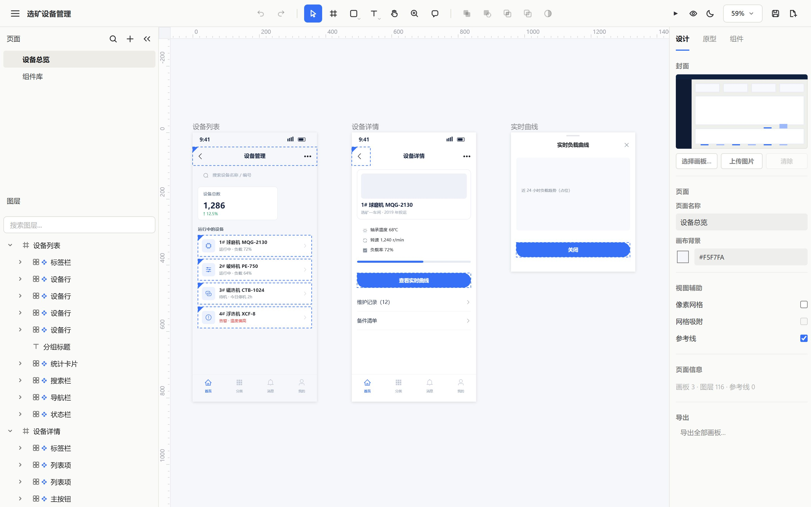
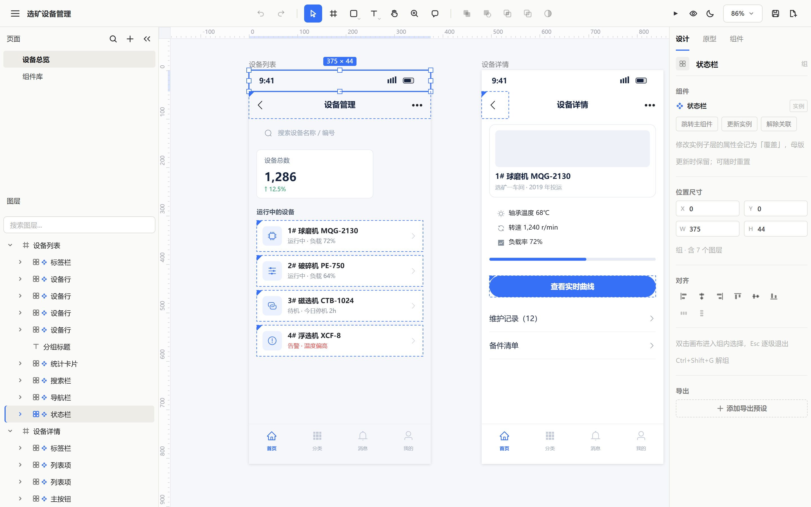
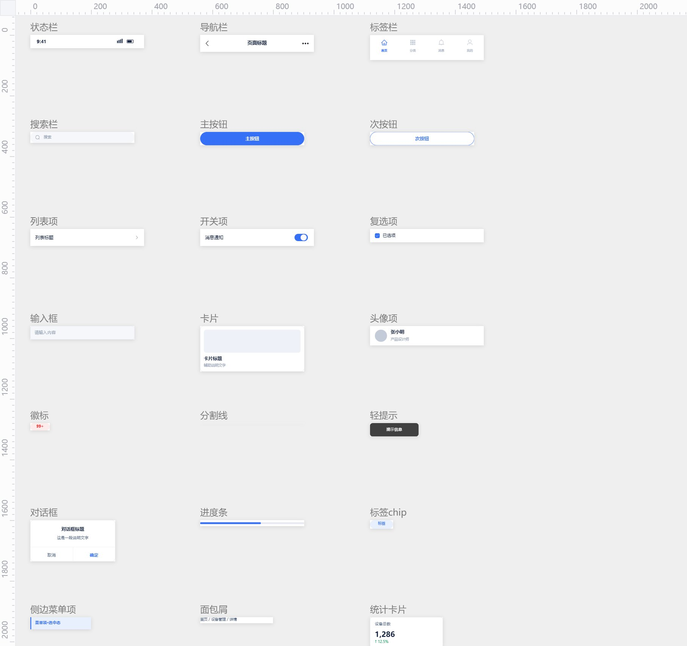
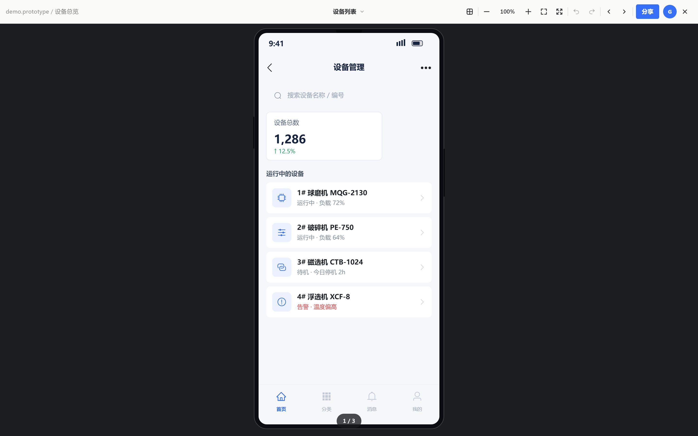

# prototype-html-builder

**一个 HTML 文件，就是编辑器，也是你的原型。**

写一段声明式 JSON，编译成 `.prototype.html`：双击打开是一个可编辑的画布，左边页面树、中间画板、右边属性面板；改完保存，写回同一个文件。不装软件、不要账号、不联网、不依赖任何外部资源。

同时它也是一个 **Agent Skill**——把 `skills/prototype-html-builder` 交给支持 Skill 的 Agent 工具，它就能按你的描述直接产出这种原型文件。

---

## 它是什么

- **一份交付物，不是一套工程**：产物只有 `.prototype.html` 一个文件，里面装着编辑器壳 + 内嵌文档 JSON（`<script type="application/json" id="__doc">`）。发给谁，谁都能打开、能改、能演示。
- **编辑器是真的编辑器**：纯 Canvas 2D 渲染，自研的选择/拖拽/缩放/对齐/图层/组件/交互系统，不是截图拼的静态页面。
- **文档就是数据**：页面 → 画板 → 节点 → 交互 → 组件，五层结构全部写进 JSON，人和 Agent 都能直接读写。

## 自研说明

本项目的画布渲染、编辑器交互、图层与属性系统、组件（母版 / 实例 / 覆盖）机制、原型播放器、单文件保存链路，**均为自研实现**：原生 JavaScript + Canvas 2D，无第三方框架、无 CDN、无运行时网络请求。

唯一的外部来源是图标：`assets/icons.json` 收录 218 个 SVG 图标路径，分别取自 **Element Plus**（125 个）与 **Ant Design**（93 个）官方开源图标集（MIT，1024 网格），用于保证产物符合通行的组件库视觉规范。图标以矢量路径内嵌，渲染走 `Path2D`，可随时换色。

## 特性一览

| 能力 | 说明 |
| --- | --- |
| 单文件产物 | 模板约 **505 KB**，示例约 **514 KB**，图标与组件全部内嵌 |
| 画布编辑器 | 页面树 / 图层面板 / 属性面板 / 标尺 / 参考线 / 像素网格 / 缩放平移 |
| 11 类节点 | `rect` `ellipse` `text` `icon` `line` `arrow` `polygon` `star` `image` `group` `bool` |
| SVG 图标 | 218 个（Element Plus 125 / Ant Design 93），按名称引用，如 `ep/search`、`ant/home` |
| 组件复用 | 27 个内置母版 + 自定义母版；实例只写差异（`overrides`），改母版全量同步 |
| 交互原型 | 5 种触发 × 5 种动作（打开画板 / 打开弹层 / 关闭弹层 / 返回上一页 / 切换变体），含转场动画与遮罩 |
| 演示模式 | 按画板尺寸自动套手机 / 桌面外框，支持缩略图条、翻页、弹层与手势 |
| 保存即原文件 | 支持 File System Access API 的浏览器可原地覆盖保存；否则下载同名副本 |
| 导出 | 画板 / 选区导出 PNG（位图内嵌） |
| 二次自动化 | 产物暴露 `window.ProtoAPI`（`getDoc` / `addNode` / `updateNode` / `setProto` / `insertComp` / `exportPNG`） |

## 快速开始

### 1. 先看看成品

直接双击 [`skills/prototype-html-builder/examples/demo.prototype.html`](skills/prototype-html-builder/examples/demo.prototype.html)，或把任意 `.prototype.html` 拖进 Chrome / Edge。点顶栏的「播放」进入演示模式。

### 2. 用 Skill 生成自己的原型

```bash
# 在 skill 根目录执行（也可用脚本绝对路径从任意目录调用）
node scripts/build-prototype.mjs spec.json -o out.prototype.html
node scripts/validate-doc.mjs out.prototype.html   # 退出码 0/1，便于接入 CI
```

### 3. 从空白模板开始

把 [`assets/template.prototype.html`](skills/prototype-html-builder/assets/template.prototype.html) 复制一份改名，直接在编辑器里画——组件库页里已经备好 27 个母版。

## 一份最小规格

```json
{
  "name": "示例应用",
  "pages": [{
    "name": "首页",
    "artboards": [{
      "name": "首页", "w": 375, "h": 812, "bg": "#F5F7FA",
      "nodes": [
        { "type": "instance", "comp": "navbar", "x": 0, "y": 44,
          "overrides": { "标题": { "text": "我的应用" } } },
        { "type": "icon", "name": "搜索", "icon": "ep/search", "size": 24, "x": 16, "y": 120 },
        { "type": "text", "text": "你好，世界", "x": 16, "y": 160, "fontSize": 20, "fontWeight": 600 },
        { "type": "rect", "name": "主按钮", "x": 16, "y": 300, "w": 343, "h": 44,
          "fill": "#3670F7", "radius": 8,
          "click": { "action": "打开画板", "target": "详情", "anim": "左滑" } }
      ]
    }]
  }]
}
```

字段全清单见 [`references/spec.md`](skills/prototype-html-builder/references/spec.md)。

## 目录结构

```
.
├── editor-prototype/
│   └── index.html                  # 编辑器壳源码（模板与产物都由它派生）
├── skills/prototype-html-builder/  # 可分发给 Agent 的 Skill 包
│   ├── SKILL.md                    # Skill 说明与工作流
│   ├── assets/
│   │   ├── template.prototype.html # 空白模板（编辑器 + 组件库页）
│   │   ├── design-kit.json         # 设计 Token + 27 个内置母版
│   │   └── icons.json              # 218 个 SVG 图标路径
│   ├── examples/
│   │   ├── demo-spec.json          # 可运行示例规格
│   │   └── demo.prototype.html     # 编译后的示例产物
│   ├── references/                 # 规格 DSL / 图标 / 设计规范文档
│   └── scripts/                    # 编译、校验、重建模板等脚本
├── wechat/                         # 公众号排版稿与配图
└── prototype-html-builder-intro.html  # 单文件项目宣传页
```

## Skill 用法（给 Agent）

把 `skills/prototype-html-builder` 放进 Agent 的 skill 目录即可。触发场景：「画原型 / 做高保真原型 / 生成 prototype.html / 移动端或大屏界面原型 / 带交互跳转的原型」。

三条硬性约束写在 `SKILL.md` 里：

1. **图标必须是 SVG**：只写 `{"type":"icon","icon":"ep/search"}`，禁止用字符符号或矩形拼图标。
2. **组件必须复用**：重复出现的 UI 用实例引用母版，只通过 `overrides` 改文案/颜色/图标。
3. **遵循 Element Plus / Ant Design 规范**：颜色、字号、间距、圆角取 `assets/design-kit.json`。

| 脚本 | 用途 |
| --- | --- |
| `build-prototype.mjs` | 规格 → 原型文件（主入口） |
| `validate-doc.mjs` | 校验产物（图标存在性 / id 唯一 / 交互目标 / 实例完整性） |
| `gen-template.mjs` | 由编辑器壳重建空白模板 |
| `fetch-icons.mjs` | 重新拉取 Element Plus / Ant Design 图标集 |
| `embed-icons.mjs` | 把图标注入编辑器壳的 `SVG_ICONS` 注册表 |
| `upgrade-kit.mjs` | 把设计套件中的伪图标替换为 SVG 图标节点 |

## 编辑器用法（给人）

- **保存**：`Ctrl+S` 覆盖保存（Chrome / Edge 首次会询问文件位置），`Ctrl+Shift+S` 另存为新文档。
- **撤销 / 重做**：`Ctrl+Z` / `Ctrl+Y`。内容变更后会自动存档到 localStorage，刷新不丢。
- **工具**：`V` 选择、`B` 矩形、`R` 圆角矩形、`E` 椭圆、`T` 文本、`P` 画笔、`L` 线、`C` 评论。
- **层级**：`Ctrl+]` 上移一层、`Ctrl+[` 下移一层，加 `Shift` 直接置顶 / 置底。
- **视图**：`Shift+G` 像素网格、`Shift+R` 参考线、`Shift+D` 深浅主题、方向键微调 1px（`Shift` 为 10px）。
- **演示**：顶栏「播放」进入，弹层、跳转、滑动等交互按文档 JSON 定义执行。

## 截图









## 相关文档

- [`skills/prototype-html-builder/SKILL.md`](skills/prototype-html-builder/SKILL.md) — Skill 工作流与约束
- [`references/spec.md`](skills/prototype-html-builder/references/spec.md) — 规格 DSL 全字段
- [`references/icons.md`](skills/prototype-html-builder/references/icons.md) — 图标命名与清单
- [`references/design-system.md`](skills/prototype-html-builder/references/design-system.md) — 设计 Token 与母版覆盖点
- [`prototype-html-builder-intro.html`](prototype-html-builder-intro.html) — 项目宣传页（单文件，含下载）

## 反馈

问题、建议、想要的能力，欢迎在 [Issues](https://github.com/LabronGon/prototype-html-builder/issues) 里提。如果它帮你省下了一次「文件打不开」的沟通，点个 **Star** 就够了。
